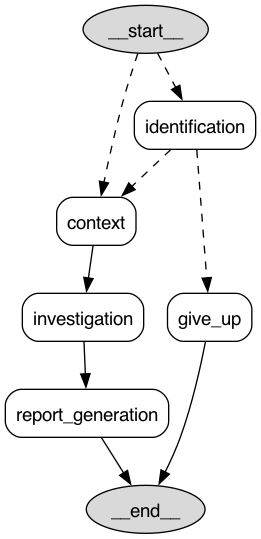

# Investigator

[](https://github.com/bronto-community/bronto-alert-investigation-agent/actions/workflows/ci.yml)
[](https://scorecard.dev/viewer/?uri=github.com/bronto-community/bronto-alert-investigation-agent)
[](https://github.com/bronto-community/bronto-alert-investigation-agent)
[](LICENSE)

A logs-based alert investigation agent for [Bronto](https://bronto.io), built with
[LangGraph](https://langchain-ai.github.io/langgraph/). Describe an alert in plain English
(even a historical one - from days or weeks ago). The agent finds the triggered monitor, investigates your logs
around it, and writes a human-readable incident report.

## Contents

- [Quick start](#quick-start)
- [What happens in a session](#what-happens-in-a-session)
- [What this is (and isn't)](#what-this-is-and-isnt)
- [Deploying it](#deploying-it)
  - [Example deployment: On Fly.io](#example-deployment-on-flyio)
  - [Deployment mode: Interactive Slack bot](#deployment-mode-interactive-slack-bot)
  - [Deployment mode: Webhook-Based](#deployment-mode-webhook-based-run-automatically-when-monitor-triggers)
- [How it works](#how-it-works)
- [Development](#development)
- [License](#license)

## Quick start

You need:

- Python **3.11+** and [`uv`](https://docs.astral.sh/uv/), **or** Docker
- A **Bronto API key** and region (`eu` or `us`)
- An API key for one **LLM provider**: Anthropic, OpenAI, or AWS Bedrock

```bash
uv sync
export BRONTO_API_KEY=…  BRONTO_REGION=eu
uv run investigator --provider bedrock --model-id eu.anthropic.claude-sonnet-5
```

Or, to try it without installing anything, run it in a container built from the
[`Dockerfile`](Dockerfile):

```bash
docker build -t investigator .
export BRONTO_API_KEY=…  BRONTO_REGION=eu  ANTHROPIC_API_KEY=…
docker run --rm -it -e BRONTO_API_KEY -e BRONTO_REGION -e ANTHROPIC_API_KEY \
  investigator investigator --provider anthropic --model-id claude-sonnet-5
```

`-it` is needed because the session asks you questions. `-e NAME` forwards a variable from your
shell, so forward the ones your provider needs (see the table below). `--rm` removes the
container when the session ends, and `docker rmi investigator` removes the image.

Configuration is entirely through environment variables. [`.env.example`](.env.example) lists
every one of them.

| Provider    | Required environment                                                          |
| ----------- | ----------------------------------------------------------------------------- |
| `anthropic` | `ANTHROPIC_API_KEY`                                                           |
| `openai`    | `OPENAI_API_KEY`                                                              |
| `bedrock`   | `AWS_REGION` (or `AWS_DEFAULT_REGION`) + `AWS_PROFILE`, or a key pair         |

A Bedrock key pair for an IAM user (`AKIA…`) is `AWS_ACCESS_KEY_ID` + `AWS_SECRET_ACCESS_KEY`.
A temporary one from SSO or assume-role (`ASIA…`) also needs `AWS_SESSION_TOKEN`.

## What happens in a session

1. **Describe the alert** in plain English, e.g. _"elevated 500s on my api gateway"_. It can be
   a historical event.
2. **Confirm the event.** The agent searches your Bronto audit log for the triggered alert that
   matches your description and asks you to confirm it. You can pick another candidate, or reply
   with more detail to send it back to search.
3. **Add a playbook or context (optional).** This could be a playbook or other useful context,
   such as how your services depend on each other. If the monitor already has a playbook in
   Bronto, the agent offers it to you.
4. **Investigation.** The agent explores the monitor and your logs to gather system context
   around the time the alert triggered. Then it drills down into your data to find a root cause.
5. **Report.** You get a write-up that answers:
   - What does this triggered alert mean, in simple terms?
   - What are its implications and impact?
   - What are its likely root causes, and what is the evidence?
   - What are the suggested next steps and remediations?

An investigation takes around a minute with Claude Sonnet 5 on the default settings. To let the
agent think harder and run for longer, raise `--max-model-calls`.

| Flag                | Default | Description                                            |
| ------------------- | ------- | ------------------------------------------------------ |
| `--provider`        | —       | Required. One of `anthropic`, `bedrock`, `openai`      |
| `--model-id`        | —       | Required. The provider's model identifier              |
| `--log-level`       | `INFO`  | Python log level (`DEBUG` for full tracing to stderr)  |
| `--max-model-calls` | `5`     | Model-call budget for the investigation loop only      |
| `--event`           | —       | Investigate an alert that is already identified, from a JSON file (`-` for stdin). For webhook and job deployments; see [The event payload](#the-event-payload) |

### Tracing

To send traces to an OpenTelemetry collector, set `OTEL_EXPORTER_OTLP_ENDPOINT` (and
`OTEL_EXPORTER_OTLP_HEADERS` if needed). Every model call and tool call becomes a span, with its
inputs and outputs. When these are unset, tracing stays off. To send them straight to Bronto:

```bash
export OTEL_EXPORTER_OTLP_ENDPOINT=https://ingestion.<region>.bronto.io
export OTEL_EXPORTER_OTLP_HEADERS=x-bronto-api-key=<your Bronto API key>
```

Prompts and completions are recorded on the spans by default; set
`OTEL_INSTRUMENTATION_GENAI_CAPTURE_MESSAGE_CONTENT=NO_CONTENT` to leave them out.

## What this is (and isn't)

This is a standalone tool you can run against real alerts. It is also a **teaching resource**:
it shows the design patterns for building an agent with LangGraph on top of Bronto, at a size you
can read end to end in one sitting.

The feature set is **deliberately small, and frozen**. Every feature it doesn't have is one less
concept between a reader and the pattern being shown. It will not grow more providers, deployment modes, input/output sources, or options.

To go further, **fork it, or copy the parts you need into your own project**. That is the
intended use. The phases under `src/investigator/phases/` each work on their own. Bug fixes and readability improvements are
very welcome. See [CONTRIBUTING.md](CONTRIBUTING.md) for what is accepted and what isn't.

## Deploying it

In addition to running the agent interactively via the CLI (as outlined in the quick start section above) you can also deploy the agent via the [`Dockerfile`](Dockerfile).
Every deployment needs 
* `--provider`
* `--model-id`
* the Bronto config described above
* the LLM provider config described above

You can run the container anywhere you like, such as on any of the many agent hosting services available these days, e.g., Fly.io (more details below).

### Example deployment: On Fly.io

The [`deploy/fly.example.toml`](deploy/fly.example.toml) file runs the agent as an interactive Slack bot and
[`deploy/fly.webhook.example.toml`](deploy/fly.webhook.example.toml) runs the  webhook mode. Copy one of those files to the repo root without `.example` in its name, then:
1. Set your desired app name in the `.toml` file, e.g., `bronto-investigator`
2. Create your app via the fly.io CLI with `fly apps create <your app name>`
3. Setup up your config for the app via the fly.io cli, with, e.g.:
```
fly secrets set BRONTO_API_KEY=... BRONTO_REGION=... ANTHROPIC_API_KEY=... SLACK_BOT_TOKEN=... SLACK_APP_TOKEN=... -a <your app name>
```
4. Deploy & launch the agnt with `fly deploy` (for the webhook config, add `-c fly.webhook.toml`).
5. You now have a live agent deployed and running on fly.io, check the logs via the fly CLI with: `fly logs`. Consult the fly.io documentation if you are having trouble deploying, and ensure you have the correct configration set (more details on slack and webhook deployments below). 
6. ???
7. $$$$ Profit $$$$

### Deployment mode: Interactive Slack bot

The same session as the CLI, run from Slack so your team can investigate together.

**Using it.** Type `/investigate OOM on the checkout hosts` in a channel the bot is in. The bot
posts _"Investigating: …"_ and runs the whole session in a thread under that message:

1. It proposes the matching alerts as buttons. Click one, or reply in the thread with more
   detail to send it back to search.
2. It asks for an optional playbook, offering the monitor's own if it has one in Bronto.
3. It posts the report into the thread.

You can also `@mention` the bot with a description, including inside an existing thread, and it
runs the session there. A bare `@mention` under a message, such as an alert, investigates that
message. It runs up to 3 investigations at once (`--max-live`). A question left
unanswered for 15 minutes ends that run, and runs in progress don't survive a restart.

The bot connects to Slack over Socket Mode, so it needs no public URL or open port, just a
container that stays up.

**Configuration.** Everything from the [Quick start](#quick-start) (Bronto and your LLM
provider), plus two Slack tokens, which you get while creating the app below:

| Variable | What it is |
| -------- | ---------- |
| `SLACK_BOT_TOKEN` | `xoxb-…`, the app's Bot User OAuth Token |
| `SLACK_APP_TOKEN` | `xapp-…`, an app-level token with the `connections:write` scope |

The container command is `investigator-slack --provider … --model-id …`. The image already
includes everything the bot needs; from source, run `uv sync --extra slack` first. The
[Fly.io example](#example-deployment-on-flyio) is set up for this mode.

**Creating the Slack app.** At [api.slack.com/apps](https://api.slack.com/apps):

1. **Create New App** → **From scratch**. Name it and pick your workspace.
2. **Socket Mode**: turn it on. Slack asks you to create an app-level token: give it the
   `connections:write` scope. That token is your `SLACK_APP_TOKEN`.
3. **OAuth & Permissions** → **Bot Token Scopes**: add `commands`, `chat:write`,
   `app_mentions:read`, `channels:history`, and `groups:history`.
4. **Event Subscriptions**: turn it on, and under **Subscribe to bot events** add `app_mention`,
   `message.channels`, and `message.groups`. Socket Mode needs no request URL.
5. **Slash Commands** → **Create New Command**: `/investigate`, with any short description.
6. **Interactivity & Shortcuts**: make sure it is on, because the alert buttons need it.
7. **Install App** → **Install to Workspace**. The **Bot User OAuth Token** it shows is your
   `SLACK_BOT_TOKEN`.
8. In Slack, invite the bot into each channel you'll use it in: `/invite @your-bot`.

In short, the app needs:

| Slack app setting | Value |
| ------- | ----- |
| Socket Mode | enabled, with an app-level token that has `connections:write` |
| Bot token scopes | `commands`, `chat:write`, `app_mentions:read`, `channels:history`, `groups:history` |
| Event subscriptions | `app_mention`, `message.channels`, `message.groups` |
| Slash command | `/investigate` |
| Interactivity | enabled |

**Reinstall the app after changing any of these settings.** Until you do, Slack silently drops
mention and message events. At startup the bot logs a warning naming any scope its token is
missing.


### Deployment mode: Webhook-Based (Run Automatically When Monitor Triggers)

Investigates every alert automatically, with no one in the loop. The agent listens on one HTTP
route. When a Bronto monitor fires, Bronto POSTs the alert to `POST /events`. The alert is
already known, so the run skips identification and goes straight to gathering context and
investigating. The report goes to the agent's logs, or to a Slack channel. Nobody is asked
anything along the way.

The webhook answers with these status codes:

- `202`: investigation started
- `200`: duplicate of an alert already started, keyed on `monitor_id` + the window start
- `401`: bad secret
- `400`: bad payload
- `503`: all `--max-live` slots (3 by default) are busy, so retry

`GET /health` needs no secret. Runs in progress and de-duplication live in memory, so run **one
instance** and don't let the host stop it between requests.

**Configuration.** Everything from the [Quick start](#quick-start) (Bronto and your LLM
provider), plus:

| Variable | Needed | What it is |
| -------- | ------ | ---------- |
| `BRONTO_WEBHOOK_SECRET` | always | A secret of your choosing. Bronto sends it in the `X-Bronto-Webhook-Secret` header, and requests without it are refused. |
| `SLACK_BOT_TOKEN` | only with `--report slack` | `xoxb-…`, the Bot User OAuth Token of a Slack app set up as in the [Slack bot section](#deployment-mode-interactive-slack-bot). `SLACK_APP_TOKEN` is not needed, because this mode only posts. |

The container command is `investigator-webhook --provider … --model-id …`, and it listens on
port `8080` (`--port`). Reports are written to stdout by default. To post them to Slack instead,
add `--report slack --slack-channel <channel ID>` and invite the bot into that channel. The image
already includes everything this mode needs. The [Fly.io example](#example-deployment-on-flyio) has a
config for this mode, `deploy/fly.webhook.example.toml`.

**Connecting a Bronto monitor.** Follow [Bronto's webhook guide](https://docs.bronto.io/integrations/webhooks)
to create a webhook, then select it as a notification destination on each monitor you want
investigated. Configure the webhook with:

- **URL**: `https://<your-host>/events`
- **Header**: `X-Bronto-Webhook-Secret`, set to your `BRONTO_WEBHOOK_SECRET` (turn on encryption
  for it)
- **Payload**:

  ```json
  {
    "monitor_id": "$monitor_id",
    "monitor_name": "$monitor_name",
    "evaluation_window_start_ts": "$start_time_window"
  }
  ```

Bronto fills in the variables when the alert fires. The fields are described in
[The event payload](#the-event-payload).

#### The event payload

The webhook and `--event` CLI parameter both take an **event payload**: one alert, already identified. The run
skips identification and goes straight to gathering context, with no description, no
confirmation prompt, and no model call spent working out what you meant. You normally never write
one by hand: Bronto fills it in from the webhook template above.

The payload is a JSON object. Two fields are required. Everything else in the body is kept and passed to the investigator.

| Field | Type | | What it is |
| ----- | ---- | --- | ---------- |
| `monitor_id` | string | **required** | Which monitor fired. Every context lookup keys on it. |
| `evaluation_window_start_ts` | integer | **required** | Unix-epoch **milliseconds**, and the **start** of the monitored window. The older name, `evaluation_timestamp`, is still accepted; when both are sent, the new name wins. |
| `monitor_name` | string | optional | The name the report uses. Falls back to `monitor_id`. |
| `triggered_at` | string | optional | ISO-8601, when the alert fired. For display only. |
| anything else | any | optional | Kept verbatim. |

Get the window start right, because a wrong value fails **silently**. It must be in milliseconds,
not seconds, and it must be the start of the window, not the time the alert fired. Otherwise the
run searches the wrong time, finds nothing, and the report reads like a quiet system. A payload
the agent cannot work from is rejected up front: the CLI exits `1` and the webhook answers `400`.

**By hand (rarely needed).** To replay a past alert without the webhook, find its audit event in
your Bronto account with the filter
`"event_info.type"='MONITOR_STATE_CHANGE' AND "service_payload.new_status"='ALERT'`. Copy that
event's `service_payload` object (not the whole event) into a file, then pass it with
`--event file.json`.

## How it works

The agent is a LangGraph state graph of four phases: **identification**, **context
generation**, **investigation**, and **report generation**. The two agentic phases are built with
LangChain's `create_agent` and sit behind wrapper nodes. Each one keeps its Reason/Act transcript
in its own checkpoint namespace, so the investigation state carries only what crosses between
phases.



The picture is generated from the compiled graph. Solid edges are unconditional. Dashed edges are
conditional routes, labelled with the routing decision. `uv run python visualize_graph.py --xray 1`
expands the agents' internals.

### Phase 1: Identification

A Reason/Act agent that turns your description into a confirmed alert. It binds two Bronto
audit-search tools plus two *human-in-the-loop* tools, and forces a tool call every turn: it
either searches more or asks you something. It can't answer in prose, so a vague description
costs no wasted turns.

The two questions are modelled as tools rather than as bare interrupts, because
`HumanInTheLoopMiddleware` only interrupts on a tool call. The middleware raises the interrupt,
renders the prompt, and applies your decision. The tool bodies run only once you have chosen.

- **`confirm_alert`** asks which alert you mean. Accepting takes the proposal, picking an
  option chooses another, and free text sends the agent back to search with your correction.
- **`confirm_playbook`** asks for an optional playbook, offering any pre-configured one. It is
  the phase's exit, so the agent ends as soon as you answer. Middleware that runs ahead of the
  interrupt fetches the monitor's configured playbook just before you are asked. That costs no
  extra model call, and the monitor id comes from the audit log event rather than from the model.

When no alert is confirmed, the phase routes to **`give_up`**, which is a node, not a tool.

### Phase 2: Context generation

A single node that assembles the **alert context** through deterministic REST lookups
(via `bronto-sdk`) plus one optional model call:

- fetch and trim the monitor, with the queries from its backing metric definition,
- resolve each monitor query to the datasets it runs against,
- (if a playbook was given) ask the model which datasets it implies,
- compute a **timeseries** of the monitor's state over the pre-trigger window,
- compute an absolute **investigation window** (epoch-ms) the later searches are scoped to.

### Phase 3: Investigation

A second Reason/Act agent, kept deliberately small. It defaults to 5 model calls, and it is the
only phase `--max-model-calls` governs. Context and report generation each make at most one call
outside that budget, and identification has its own mechanism for limiting model calls.

- The **investigator** works from the alert context and a subset of the MCP tools: `get_keys`,
  `get_key_values`, `search_logs`, `timeseries`. Requested calls run **concurrently**.
- Its **findings** (root cause, evidence, remediation, confidence) are a structured output
  bound as a tool alongside the search tools. Every turn is therefore a tool call: batch more
  searches, or conclude.
- Middleware scopes each time-aware tool call to the alert context's investigation window. It
  strips `time_range` from the schema the model sees and defaults the absolute epoch range from
  the alert context. Failed calls are retried with backoff. There is no limit on tool result size, 
  so a very wide log search can grow the transcript quickly.
- The call budget spends its **last** turn on the conclusion rather than cutting the loop off.
  On that turn the search tools are unbound, leaving the findings tool as the only thing
  callable, so investigation that hits the limit and is cut short, still ends with findings. 

### Phase 4: Report generation

A single plain model call turns the alert context and findings into the human-readable report. The report
covers what the event means, its implications, the root cause and evidence, and remediation and
next steps. If there are no findings, because the investigation's call budget ran out mid-search,
the report says so and spends no model call at all.

## Development

```bash
uv sync --all-extras                # project, both extras, and dev tools
just prepare                        # format, lint, typecheck, tests — green before every commit
just graph                          # regenerate graph.png
```

This needs [`uv`](https://docs.astral.sh/uv/) and [`just`](https://just.systems/). See
[CONTRIBUTING.md](CONTRIBUTING.md) for the full list of recipes and what a change needs to be
accepted.

The suite mocks every model and Bronto call. `tests/conftest.py` provides `ScriptedChatModel`,
a real `BaseChatModel` that pops pre-scripted responses and records the prompts and per-call
kwargs it was given. A duck-typed double will not do, because `create_agent` drives the model
through Runnable machinery and calls `bind_tools` on every turn.

`graph.open_app`, which opens the MCP session, is the one function with no unit tests. It needs
a live server, so it is verified by running the CLI.

## License

MIT — see [LICENSE](LICENSE).
